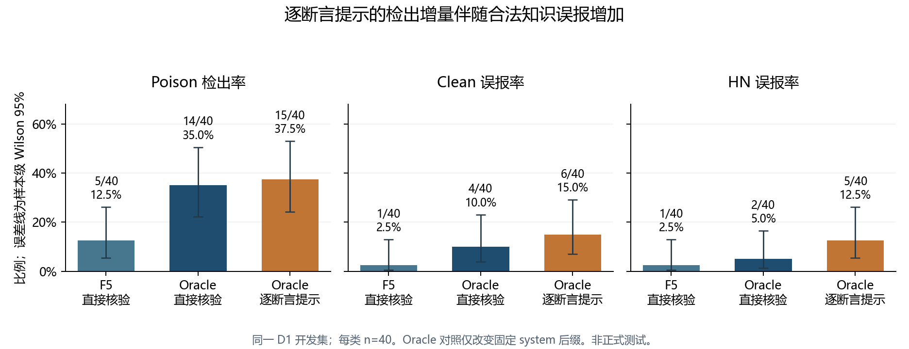
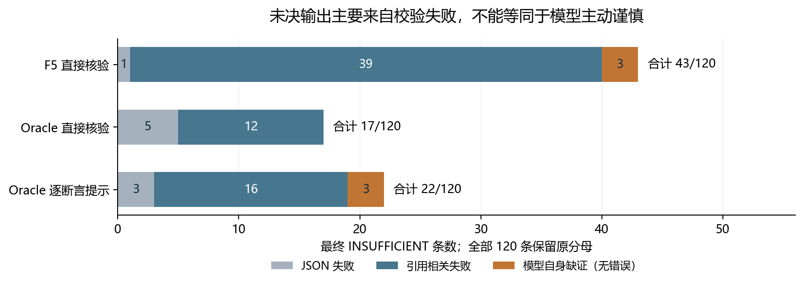

# D1 核验基线已完成，逐断言提示未带来无额外误报的改善

项目负责人审阅稿 | LLMGuard Research Framework | Stage 6.1 / Paper 1

报告日期：2026-10-31（Asia/Tokyo）；证据截止：`4dc9161e79b79ece70a7c17144175a19b985770d`。报告编号：`P1-L0-D1-BASELINE-OWNER-REPORT-20261031-V1`。

**提交建议：结束本轮 D1/L0 开发基线及固定提示对照，保存负结果，停止追加提示词和 GPU 预检。项目负责人最终验收仍待审阅。**

## 负责人摘要

- 本轮已完成 FULL01 的 240 条新预测、一次不重新推理的离线审计，以及 Oracle 逐断言提示的 120 条固定对照，共 360 条新开发预测。原始失败、预测和指标未被本报告改写。[S1][S2][S3]
- 直接核验检出有限：F5 为 5/40（12.5%），Oracle 为 14/40（35.0%）。引用校验仅拦住 F5 的 1 条原正确 CONTRADICT，Oracle 为 0 条；低检出率不能主要归因于 parser。[S1][S2]
- 逐断言提示净增 1 个检出，却净增 5 个合法样本误报；严格三元组仍为 8/40。Recall 配对区间为 -10.3 至 +11.6 个百分点，未满足事前“检出增加且 Clean/HN 误报不增加”规则。判断保留为 `TRADEOFF_FPR_INCREASED`。[S3][S4]
- 数据已用于开发，样本量较小。本报告不宣称正式测试、跨领域泛化、部署有效性、方法创新或所有论文基线已经完成。这里的 L0 是 Qwen 核验基线，不等同于历史 `S6.1-R0` 外部基线复现任务。[S4][S12]

## 1. 本轮要回答的问题与实际范围

研究问题是：面对自然、相关但局部事实被修改的短命题，冻结的开源大模型能否利用给定证据正确区分冲突、支持与证据不足，同时保留合法更新、历史版本和困难负样本？本轮先建立直接核验基线，再判断输出合同是否掩盖能力，最后检验一次逐断言对齐提示是否带来改善。[S1-S4]

实际评价单元是 **40 个完整三元组、120 条 Candidate、13 个事实家族**；Poison、Clean、HN 各 40 条。Poison 分层 S1/S2/S3 为 12/15/13；另 8 组、24 条 HOLD 保持排除。本报告沿用冻结分层，不重新定义其含义，也不将长 Evidence 包误称为已验证长文档污染检测能力。[S1][S12]

F5 使用冻结 Hybrid Top5 完整文本；Oracle 使用原分配的冻结 E1/E2，合法空 E2 不补造。Oracle 是非部署诊断条件，并非逐样本必然更优的数学上界。两组文本体量、覆盖及干扰不同，差异不能全部归因于检索召回。[S1]

本报告的直接证据是固定 Git 提交中的协议、脱敏结果、审计记录和代码。控制端核实了这些文件及其内容身份，并独立复算分子/分母、总数和 Wilson 区间；**没有取得 5090 私有逐条预测、标签和归档，未独立重放逐条评分或家族 bootstrap。** 私有哈希列为来源报告值，不表示文件已在控制端复核。详细证据分级见第 8 节与机器清单。

## 2. 模型、输出和评价合同

模型为 `Qwen/Qwen2.5-7B-Instruct`，revision `a09a35458c702b33eeacc393d103063234e8bc28`。运行使用 RTX5090、bf16、GPU-only、batch=1、Torch 2.8.0+cu128、Transformers 4.57.1；使用已验证的显式 GQA K/V 展开与 memory-efficient SDPA，持久 KV cache 保持 4 头。[S5][S6]

固定 seed=20261029，greedy（`do_sample=false`、`num_beams=1`），确定性硬开关开启、TF32 关闭。总上下文 32768、输入上限 31744、输出上限 1024、显存预留硬限 30 GiB、时间限额 12 小时。无量化、CPU offload、正文截断或证据减少；容量预检专用的强制 1024-token 输出参数未带入正式开发生成。[S1][S3]

输出是 SUPPORT、CONTRADICT、INSUFFICIENT 三态和可定位的原文引用。SUPPORT 要有外部证据；CONTRADICT 要有外部反证或两个不同的内部冲突 span。格式或引用校验失败转换为最终 INSUFFICIENT，保留原 `model_verdict` 和错误。引用逐字匹配只证明 span 可定位，不证明推理成立。[S9]

| 指标 | 分子 / 分母及失败处理 |
| --- | --- |
| Poison Recall | 最终 CONTRADICT 的 Poison / 全部 40 条 Poison；分层分母为 12/15/13 |
| Clean / HN FPR | 最终 CONTRADICT 的相应合法类 / 该类全部 40 条 |
| Precision | Poison TP / 全部最终 CONTRADICT；失败及弃权不产生检出 TP |
| 弃权率 | 最终 INSUFFICIENT / 全部 120 条；包括输出失败与模型自身缺证 |
| 严格三元组成功 | 同组 Poison=CONTRADICT 且 Clean、HN 均=SUPPORT / 40 组 |
| 错误 SUPPORT | 最终 SUPPORT 的 Poison 条数，区别于单纯未检出 |

所有输入拒绝、输出失败和弃权留在原分母，不使用仅“成功解析子集”的成绩替代主报告。没有合法连续风险分数，不计算 AUROC/AUPRC。样本级 Wilson 95% 与 13 家族 bootstrap 是不同的不确定性表达；配对区间来自原报告的 2000 次、seed=20261029 家族重采样，不能从本报告汇总表反推独立重算。[S1][S3][S10]

## 3. 实验路线、失败与恢复记录

| 步骤 | 已发生的事实 | 本报告如何保留 |
| --- | --- | --- |
| 本机设备门 | 控制端最初仅见 RTX5060，未代替指定 5090 推理 | 保留硬件身份阻断，不当作模型能力失败 [S7] |
| R01 | 5090 加载通过；合成语义 4/5，旧硬门停止，D1 未评分 | 原 HARD_STOP 不改写 [S8] |
| R02 | Owner 将合成语义准确率改为诊断项；5 条 F5 raw 后在 10820-token 输入 OOM | 不把局部输出当完整结果或零分 [S11] |
| R03 | 改为 7200 输入上限；Git 长度盘点预计 F5 33/120、Oracle 102/120 可调用；后续报告本地 COMPLETE | 最终指标未纳入；105/240 是长度盘点，不冒充完整实测拒绝数 [S13] |
| R04 | Worker 回传 math SDPA 对 26493 输入申请 73.21 GiB 后 OOM，原报告只在 5090 | 列为 Worker 回传、未本地复核；不伪造 Git 原始报告 [U1] |
| R05 | 数值、实际 efficient kernel、确定性和最长输入通过；缓存预留增长超过原 512 MiB 门 | 保留 BLOCKED 及 dispatcher 误判说明，不事后改判 [S5] |
| R06 | 35 次合成调用；同工况 allocated 不增，reserved 在首次长输入后形成平台 | PASS 只覆盖固定合成负载，不代替真实 240 条 [S6] |
| FULL01 | 新 240 条预测、封存、独立评分和归档完成 | 真实开发结果；执行 830bb5b，收口 bfc9685 [S1] |
| 离线审计 | 重放现有输出的错误归因；原 272 文件索引不变 | 不重新推理、不修 parser、不替换成绩 [S2] |
| ALIGN01 | 固定 system 后缀、同 Oracle 120 条，单次新调用；无第二版提示 | 保留失败的收益假设；执行 4f4ece3，收口 4dc9161 [S3][S4] |

FULL01 之前的 `b058601` 在写出运行目录前因变量遮蔽退出；实际执行提交为修复后的 `830bb5b`。这不是运行中修改代码。历史 R03 的最终拒绝数不能从中途“85 条”描述或冻结长度预计值补写；本报告不提供未经封存记录支持的 R03 成绩。[S1][S13][U1]

## 4. 结果：直接核验和一次固定提示对照

| 条件 | S1 TP/N | S2 TP/N | S3 TP/N | 总 Recall | Clean FPR | HN FPR | Precision | 严格三元组 |
| --- | --- | --- | --- | --- | --- | --- | --- | --- |
| L0-F5 | 3/12 | 0/15 | 2/13 | 5/40 = 12.5% | 1/40 = 2.5% | 1/40 = 2.5% | 5/7 = 71.4% | 1/40 |
| L0-Oracle | 5/12 | 5/15 | 4/13 | 14/40 = 35.0% | 4/40 = 10.0% | 2/40 = 5.0% | 14/20 = 70.0% | 8/40 |
| Oracle-ClaimAligned | 4/12 | 6/15 | 5/13 | 15/40 = 37.5% | 6/40 = 15.0% | 5/40 = 12.5% | 15/26 = 57.7% | 8/40 |

来源：[S1][S3]。F5 和 Oracle 是证据包对比；只有 Oracle 与 ClaimAligned 构成同一证据、同一模型/预算/解析器、仅固定 system 后缀改变的提示对照。新增指令也增加了输入 token，不称作计算成本完全相同。

图 1 将检出和合法知识误报并列。高检出必须与误报共同评价；F5 的低误报不抵消 35/40 的漏检。样本级区间不代表独立家族的泛化区间。

### 4.1 Oracle 改善有证据，但不是纯检索因果效应

Oracle 相对 F5 净多检出 9/40，即 +22.5 个百分点；原报告的家族配对 Recall 差值区间为 +10.0 至 +40.5 个百分点。Clean/HN FPR 分别增加 7.5/2.5 个百分点，配对区间均跨过零。因为证据覆盖、包长度、干扰和输出校验成功率共同变化，不能写成“检索改进带来 22.5 个百分点收益”，也不把 Oracle 称为部署方法。[S1][S2]

### 4.2 逐断言提示没有通过事前收益规则

新增检出 4、丢失检出 3，净增 1；新增合法类误报 6、消除 1，净增 5。Recall 从 35.0% 到 37.5%，Clean FPR 从 10.0% 到 15.0%，HN FPR 从 5.0% 到 12.5%。Precision 下降 12.3 个百分点，严格三元组没有增加。[S3]

| 新条件减 Oracle | 点差（百分点） | 原报告家族配对 95% 区间（百分点） |
| --- | --- | --- |
| 总体 Recall | +2.5 | -10.3 至 +11.6 |
| Clean FPR | +5.0 | 0.0 至 +13.2 |
| HN FPR | +7.5 | -5.9 至 +20.9 |
| S1 Recall | -8.3 | -38.5 至 +18.2 |
| S2 Recall | +6.7 | 0.0 至 +21.4 |
| S3 Recall | +7.7 | -25.0 至 +30.0 |

总体区间跨过零，不能宣称显著提高；S2 区间下沿为零，也不作为独立成功结论。不能按正确 S 标签挑选不同条件拼接成绩。事前“检出增加且 Clean/HN 误报不增加”在本批观测中失败，保留 `TRADEOFF_FPR_INCREASED`。这否定的是本次固定提示的预定收益，不是所有结构化核验方案。[S3][S4]

Poison SUPPORT 净减少 4（19 到 15），但 Poison 的最终 INSUFFICIENT 从 7 到 10、CONTRADICT 从 14 到 15。不能把错误 SUPPORT 的全部下降写成事实核验提升。历史 HN 11 条中，新条件误报 3 条、支持 7 条、未决 1 条；Oracle 原为误报 1、支持 10、未决 0。[S3]

## 5. 离线归因：引用合同有问题，但不足以解释低检出

| 条件 | JSON 失败 | 引用相关失败 | 模型自身缺证且无错误 | 最终 INSUFFICIENT |
| --- | --- | --- | --- | --- |
| F5 | 1 | 39 | 3 | 43 |
| Oracle | 5 | 12 | 0 | 17 |
| ClaimAligned | 3 | 16 | 3 | 22 |

来源：[S1-S3]。这是最终未决的互斥组成，不把模型生成行为与校验器拒绝混成一类。

F5 的 40 条输出失败首因是：引文不在指定正文 30、UID 不存在 8、JSON 语法 1、SUPPORT 缺外部证据 1；Oracle 是引文不在指定正文 12、JSON 语法 5。附加诊断标签可能重叠，不能重复相加。校验失败不是自动证明引用幻觉；引用成功也不自动证明事实判断正确。[S2]

最有决定性的归因是：原本正确的 Poison CONTRADICT 被转为未决，F5 仅 1 条，Oracle 0 条。F5 原 CONTRADICT 总共只有 6/40；按原输出直接放宽引用约束，不足以把它变成高检出基线，这也不是可替换的“修复后分数”。校验通过后仍错误 SUPPORT 的 Poison 是 F5 22 条、Oracle 19 条。[S2]

120 对 F5/Oracle 中，仅 F5 校验失败 36、仅 Oracle 失败 13、两边失败 4、均通过但判决不同 12、均通过且相同 55。Worker 对私有代表案例报告了机关角色、数值变化方向、比较指标绑定错误；这些具体语义案例未在控制端独立检查，作为待负责人下钻的案例解释，而非新增 Ground Truth。[S2]

## 6. 成本、运行身份与风险

| 已评分运行 | 新调用 | 输入 token | 输出 token | 生成阶段秒数 | 实测最大 reserved |
| --- | --- | --- | --- | --- | --- |
| FULL01（F5 + Oracle） | 240 | 2,174,399 | 45,451 | 2,517.82 | 31,249,661,952 B = 29.10 GiB |
| ORACLE-ALIGN01 | 120 | 510,139 | 21,390 | 863.32 | 21,657,288,704 B = 20.17 GiB |
| 两次合计 | 360 | 2,684,538 | 66,841 | 3,381.14（约 56.35 分钟） | 不相加 |

来源：[S1][S3]。合计不是完整项目成本，不含预检、R03、安装、CPU 审计或端到端等待。FULL01 Oracle 的输入/输出分别为 465,859 / 21,735 token；新提示输入增加约 9.5%，输出减少约 1.6%。对照生成时间未在所读脱敏记录中单列，故不计算速度提升。[S3]

30 GiB = 32,212,254,720 字节。FULL01 实际最小合同余量只有 962,592,768 字节，即 **0.896 GiB**，虽未超过该次 30 GiB 硬门，但不声称完整运行始终保留了 1 GiB 余量。R06 合成负载峰值 20.67 GiB 不能替代真实 FULL01 的 29.10 GiB；本报告不据预检推广任意长度或无限运行稳定性。[S1][S6]

CPU 测试、静态身份核验、GPU 工程通过和科学有效性是不同证据。推送成功只证明提交可达，不证明数值或科学结论；旧推送审查、握手失败与模型结果分开保留。[S3][S6]

## 7. 收口判断与负责人待审事项

本轮的完成目标是建立可追溯的直接核验基线、解释主要失效路径并执行一次固定提示对照；这三个目标已有开发证据。高性能检测或无额外误报的收益没有得到支持。

建议负责人审阅后确认：

1. 结束本轮 D1/L0 开发基线和固定提示探索，不再追加提示词版本、F5 重跑或 GPU 预检。
2. 保留 FULL01、离线审计和 ALIGN01 及全部负结果；R05 继续为历史 BLOCKED，R06 继续为其协议下 PASS，不追溯改写。
3. 将科学状态记录为“本轮基线已测；方法有效性未建立；语义绑定仍是主要观察瓶颈”。
4. 后续先重新审视方法机制、基线充分性与独立验证设计；任何新模型、VACE-LM、D2/D3 实验或正式协议变动另行决定。报告不产生这些授权。

**本报告是收口建议和证据整理，不代替负责人最终验收。** 没有负责人签署或明确决定，不写 `HUMAN_ACCEPTED`，不把报告创建日期当实验发生日期。

可用于阶段汇报的结论：

> 在固定 Qwen2.5-7B、冻结证据和严格输出合同下，D1 直接核验的有效检出有限。离线审计显示，引用校验并非漏检的主要解释。一次固定逐断言提示仅净增 1 个检出，同时净增 5 个合法样本误报，未满足事前改进标准。本轮结果支持结束该提示探索，并以负结果约束后续方法主张。

## 8. 证据包、核验等级与复核入口

机器可读数据见 [RESULTS_REVIEWED_V1.json](RESULTS_REVIEWED_V1.json)，复算表见 [RESULTS_TABLE_V1.csv](RESULTS_TABLE_V1.csv)，完整来源和私有哈希见 [SOURCE_REGISTER_V1.json](SOURCE_REGISTER_V1.json)。[报告验证记录](REPORT_VALIDATION_V1.json)列出算术、文件链接、受保护代码和来源身份核验结果。

证据分为：

- **控制端已核实**：截止提交、Git 中协议/脱敏记录/代码的存在和字节身份；汇总数的加总、比例、转移差及 Wilson 复算。原记录快照保存于本目录 `evidence/`，原仓库文件不变。
- **Worker 归档报告值**：私有预测、标签、配置锁、预测锁和归档的 SHA256，以及逐条重放/272 文件不变等结论。控制端未获得私有原件，未将来源报告伪装为独立复核。
- **未知或未覆盖**：R03 最终评价表、R04 原始文件哈希、独立重放全部逐条评分、独立复现家族 bootstrap、负责人最终科学验收、正式测试和泛化。

私有 FULL01 根目录为 Worker 的 `D:\paper1\VACE-L0-D1-20261030-FULL01`，ALIGN01 为 `D:\paper1\VACE-L0-D1-20261030-ORACLE-ALIGN01`。它们不是本报告目录内的本地文件。负责人若需原始下钻，应由有权限的原持有方按清单核验；不得将正文、标签或完整私有归档推入 Git。

### 已读取来源

- [S1] [FULL01 授权与封存结果](evidence/SRC-FULL01.md)；收口提交 `bfc9685`。
- [S2] [FULL01 离线输出归因](evidence/SRC-AUDIT.md)；提交 `cc69a93`。
- [S3] [Oracle 逐断言对照结果](evidence/SRC-ALIGN-RESULT.md)；提交 `4dc9161`。
- [S4] [Oracle 逐断言固定协议](evidence/SRC-ALIGN-PROTOCOL.md)；执行冻结提交 `4f4ece3`。
- [S5] [R05 显式 GQA 预检](evidence/SRC-R05.md)。
- [S6] [R06 稳定性预检](evidence/SRC-R06.md)。
- [S7] [最初设备门](evidence/SRC-DEVICE.md)。
- [S8] [R01 合成门阻断](evidence/SRC-R01.md)。
- [S9] [原 prompt 与 parser](evidence/SRC-PARSER.txt)；执行文件及 Git 身份见机器清单。
- [S10] [FULL01 评价实现](evidence/SRC-EVAL-FULL.txt)及 [ALIGN01 评价实现](evidence/SRC-EVAL-ALIGN.txt)。
- [S11] [R02 OOM 记录](evidence/SRC-R02.md)。
- [S12] [D1 首轮准入与开发结果](evidence/SRC-D1-DEV.md)、[研究方案权威文件](evidence/SRC-RPA.md)。
- [S13] [R03 长度限制披露](evidence/SRC-R03.md)。
- [U1] 本对话中项目负责人转交的 R04 Worker 报告及后续 R03 状态说明；非本地原始文件，不冒充已读取的 Git 原件。

本报告不调用外部模型、不开新实验，不修改历史数据、Guide、人工返回或模型代码。停止于 `OWNER_REPORT_READY / OWNER_REVIEW_REQUIRED`。
