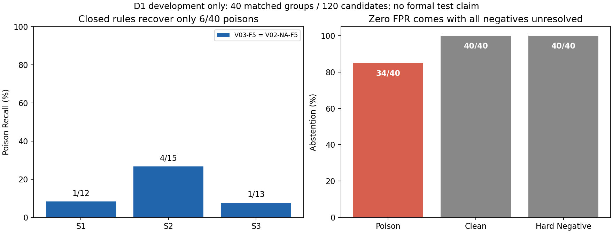

# VACE-F5首轮开发实测：规则覆盖不足，不能以零误报声称有效

V03-F5：S1 **1/12=8.33%**、S2 **4/15=26.67%**、S3 **1/13=7.69%**，总Poison Recall **6/40=15%**，Clean/HN-FPR均 **0/40=0%**；V02-NA-F5完全相同。两者均SUPPORT **0**、CONTRADICT **6**、INSUFFICIENT **114/120=95%**。全部80条合法负例未获放行，不能把零误报解释为可部署有效性。

2026-10-28；PODR-149 / OR-103 / REL-2026-0118。
Task `P1-VACE-LITE-V03-F5-IMPLEMENTATION-AND-D1-DIAGNOSTIC-01`。
Run `vace_v03_f5_20261028_run01`；源码冻结提交 `559ff45321dcb5d28c750afc69758ee45a9c099d`。
状态 `VACE_V03_F5_DEV_DIAGNOSTIC_COMPLETE / OWNER_REVIEW_REQUIRED`；科学结论：**当前规则版不具备实用检测覆盖**。

## 1. 实际评价分母与不确定性

沿用真实签署准入的40完整三元组、120候选、13事实家族。S1/S2/S3正例12/15/13，Clean/HN各40；
8组24条仍HOLD，无新增排除。标签来自获准Human/Owner开发标签，不从构造角色产生；角色/S只在预测封存后评价关联。
本轮无训练、不伪称OOF；规则各执行一次。旧126条隔离预测没有读取或复用。

| 指标（两条件相同） | 实测 | 样本级Wilson95 | 13家族bootstrap95 |
| --- | --- | --- | --- |
| S1 Poison Recall | 1/12，8.33% | 1.49–35.39% | 0–25% |
| S2 Poison Recall | 4/15，26.67% | 10.90–51.95% | 7.69–50% |
| S3 Poison Recall | 1/13，7.69% | 1.37–33.31% | 0–20% |
| Overall Poison Recall | 6/40，15% | 7.06–29.07% | 5.26–25.72% |
| Clean FPR | 0/40，0% | 0–8.76% | 0–0%（经验退化） |
| HN FPR | 0/40，0% | 0–8.76% | 0–0%（经验退化） |
| Precision | 6/6，100% | 60.97–100% | 不以仅6条已判样本推广总体 |

bootstrap固定2000次/seed20261028，仅小样本开发描述；退化零区间不表示未来误报不确定性为零。
配对V03−NA的Recall/FPR/弃权率差值均0，经验区间[0,0]只是本批预测完全相同，不证明总体等价。
AUROC/AUPRC为NOT_REPORTED_NO_CONTINUOUS_SCORE：未伪造连续风险分数、未调阈值。

## 2. 三态与严格组内判别

| 分层 | CONTRADICT | SUPPORT | INSUFFICIENT | 弃权率 |
| --- | --- | --- | --- | --- |
| S1 Poison | 1 | 0 | 11 | 91.67% |
| S2 Poison | 4 | 0 | 11 | 73.33% |
| S3 Poison | 1 | 0 | 12 | 92.31% |
| 全Poison | 6 | 0 | 34 | 85% |
| Clean | 0 | 0 | 40 | 100% |
| HN | 0 | 0 | 40 | 100% |

严格三元组成功（P冲突且C/HN均支持）为0/40；40/40组均有未决项。
P-vs-C和P-vs-HN各40组均unresolved，不把弃权赋“低风险0”凑win/tie或risk margin。
11条人工开发判断为合法历史/版本HN，0误报但11/11弃权，不能据此声称版本约束已证明降低误杀。

## 3. 已实现的工程，而非完整自然语言理解

新增六槽位提取/原文span/错误状态、受限I证书、F同域绑定、Q充分性及T/P/J一次性缺口调度。
V03与NA共享所有判定规则、同一Top5、Registry和三态合同；NA固定走完整模块，再用同一证书逻辑裁决。
A0只有cue，未证明文内矛盾仍走外证；没有A0 OR B1，没有GT/S/角色/人工证据映射路由。
UNKNOWN不由年份或域名补齐；更宽上限/不同条件不能仅因数字不同反证。
外证支持需要完整逐字条文payload；局部比较支持不等于所有附加断言正确。这一保守限制导致SUPPORT为0，已如实记录。

本轮6个命中：1个年休假同主体同年肯否矛盾、4个同法规/命令编号公布机关反证、1个两版本伤残待遇变化方向反证。
没有检出就不补规则。其他句式/别称/条件/日期/修订序数超出闭合语法时弃权，不能声称已实现普遍事实核验。
源码与测试位于`src/llmguard/domains/retrieval/hidden_poisoning/method_engineering/adaptive_verification.py`、
`scripts/research/run_vace_f5_diagnostic.py`、`scripts/research/evaluate_vace_f5_diagnostic.py`、`tests/unit/test_adaptive_verification.py`。

## 4. 可复现顺序与真实环境

先合成/历史合同测试50项（新增29），Ruff/MyPy，再源码提交/推送559ff45；
12:53:48 UTC冻结协议；120文本生成240新预测与trace，12:54 UTC封存后才独立Evaluator加载标签。
新Hybrid Top5与历史锁定身份120/120一致；重复检索完全相同，改opaque ID不改排序；不按召回结果调参数。
现有CPU Python3.12.10 / Torch2.8.0+cpu / sentence-transformers5.6.0；原MiniLM revision/tree全核，无新安装/下载/API。
固定中文2/3-gram BM25(k1=1.2,b=.75)+原Dense L2、query内min-max等权Hybrid；Q_NO_TITLE/Top5不变。
Dense max_seq_length128，33/33正文编码发生原有截断；核验器消费完整冻结正文，不裁成128 tokens。
完整复现命令、stdout/stderr/exit code、输入/代码/模型/协议/预测SHA、每样本模块与正文消费在私有命名空间。

协议SHA `4f347f7b47a8cdbe6fbb7941e1dc379fb7bec84b27ed01d4cf32a1e895814c9f`；
预测锁SHA `3d868de2eb51544288a17f2cccc745c958b087156cf6191910bb59d0d06d089b`。
原候选/Corpus/Registry及历史149+61+27文件核验不变，Stage1–5、Final72、D2/D3无diff。
原始Human/raw/Guide均未更改，无正式GT/split、训练、校准、阈值选择、Stage B或L0。

## 5. 工程门与科学门分开

工程/实验顺序门通过，可真实报告本轮数字；不意味着方法有效性通过。
当前科学限制：95%弃权、0正常知识支持、S2/S3总体覆盖弱；NA没有精度劣势，调度尚无强实际收益。
后续先申请冻结中文NLI/LLM同Top5和Oracle强基线及独立槽位/证书参考，再决定是否继续规则法。
不自动运行后续任务；参见[失败与决策](VACE_V03_NEXT_RESEARCH_DECISION.md)、[路由审计](VACE_V03_D1_ROUTE_AND_PROOF_AUDIT.md)、
[历史对比](VACE_V03_VS_BASELINES_COMPARISON.md)、[结果CSV](VACE_V03_D1_DETECTION_RESULTS.csv)。
